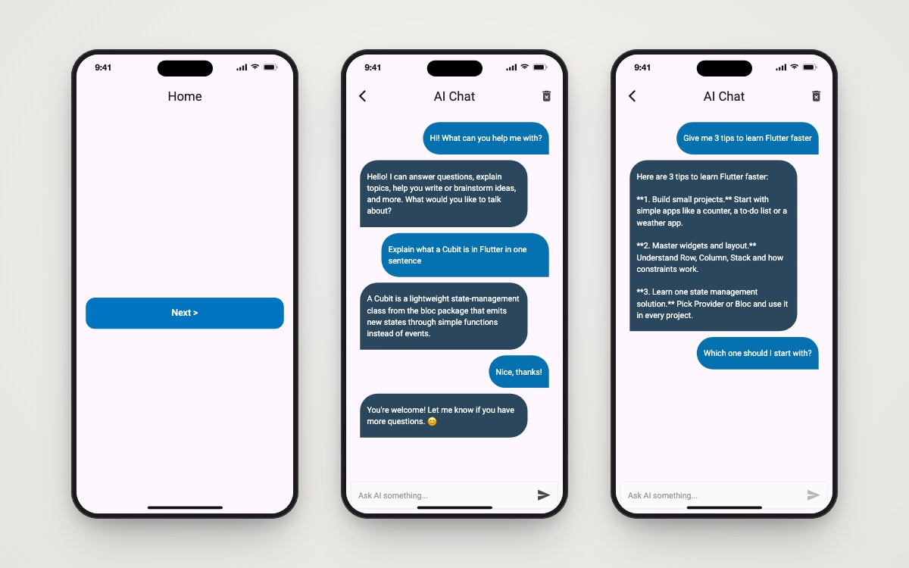

<h1 align="center">AI Chat</h1>

<p align="center">A Flutter chat client for Google Gemini, using Firebase AI Logic, with chat history saved on the device.</p>

<p align="center">
  
  
  
  
  
</p>

<p align="center">
  
  <br/><sub>Home · AI chat · Waiting for a reply</sub>
</p>

## About

A chat app that sends your messages to **Gemini 2.5 Flash** through the `firebase_ai` SDK and shows the replies as chat bubbles. The app has no backend of its own: the model is called through Firebase AI Logic, so you do not need a separate Gemini API key. The conversation is saved as JSON in `shared_preferences`, so it is still there after a restart, and you can clear it with one tap.

## ✨ Features

- 🤖 **Gemini replies**: each prompt goes to `gemini-2.5-flash` with `FirebaseAI.googleAI().generativeModel(...)`.
- 💬 **Chat bubbles**: your messages and the AI's replies are styled differently, in a scrolling list that follows new messages.
- 💾 **Saved history**: messages are saved to and restored from `shared_preferences`.
- 🗑️ **Clear chat**: one button in the app bar deletes the saved history.
- ⏳ **Send lock**: the send button is disabled while a reply is loading; errors appear in the chat.
- 🧭 **Route table**: `onGenerateRoute` with a 404 fallback page.

## 🛠 Tech stack

| Concern | Choice |
|---|---|
| AI | `firebase_ai` (Firebase AI Logic → Gemini Developer API), `firebase_core` |
| Persistence | `shared_preferences` |
| Structure | Feature-first folders (`core/` + `features/home/presentation`) |
| Also included | `flutter_bloc`, `get_it`, `dartz`, `firebase_auth`, `modal_progress_hud_nsn`, ready for the next features |

## 🏗 Project structure

```
lib/
├── core/
│   ├── errors/             # Failure, ServerFailure, CustomException
│   ├── helper_functions/   # onGenerateRoute, showErrorBar
│   └── widgets/            # ChatBuble, custom app bar / button / text field / HUD
├── features/home/presentation/views/
│   ├── home_view.dart      # start screen
│   ├── Ai_view.dart        # chat screen
│   └── widgets/            # HomeViewBody, AiChatScreen
├── constant_file.dart
├── firebase_options.dart
└── main.dart               # Firebase.initializeApp + MaterialApp
```

## 🚀 Getting started

**Prerequisites:** Flutter SDK (Dart `^3.9.2`), a Firebase project, and the [FlutterFire CLI](https://firebase.google.com/docs/flutter/setup).

```bash
git clone https://github.com/youssef336/AI_chatgpt.git
cd AI_chatgpt
flutter pub get
```

To use your own Firebase project:

1. In the Firebase console, enable **Firebase AI Logic** with the **Gemini Developer API** provider.
2. Run `flutterfire configure` to regenerate `lib/firebase_options.dart` and the platform config files.
3. Start the app:

```bash
flutter run
```

## 👤 Author

**Youssef Belal Zakaria** · [GitHub @youssef336](https://github.com/youssef336)

⭐ If you like this project, give it a star!
